# uptick

A desk ticker for crypto and stock prices on a 64x32 RGB LED panel, driven by an Adafruit Matrix Portal S3. Everything is set up from a web page the device serves on your network - no app, no account, and no API keys needed for the default sources.

- **Three layouts:** one feed at a time with a price chart, a two-row horizontal scrolling ticker, or a vertical scrolling list
- **Crypto and stocks:** Binance, Coinbase and CoinGecko for crypto; Yahoo Finance for stocks, ETFs, indices, futures and currencies, with pre-market and after-hours prices
- **Up to 32 feeds**, checked against their source before they are saved, reorderable, and exportable to a file
- **Flicker-free** DMA-driven display with hardware brightness and a tunable color palette
- **Weather:** current conditions with an animated icon and a 5-day forecast for up to 8 cities
- **Clock with date:** nine themes - Matrix rain, split-flap, retro LED, Pong, Tetris, the real sky, an analog face, a little platform game and Snake - in any of your cities' time zones
- **Mix and match:** tickers, weather and clock in rotation, or any one on its own
- **Christmas theme:** falling snow that settles on the chart, a snowman or a tree, and Santa flying past now and then

## What it looks like

<table>
<tr>
<td align="center">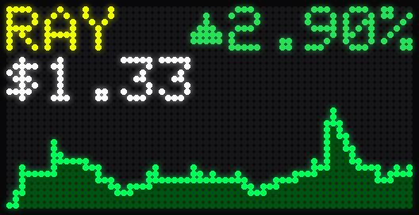<br>One feed at a time, with its chart</td>
<td align="center">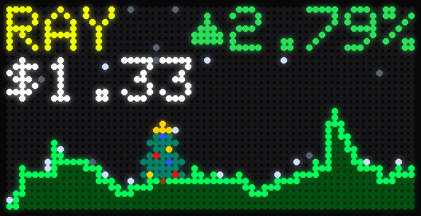<br>The Christmas theme: snow settling on the chart, and a tree</td>
</tr>
<tr>
<td align="center">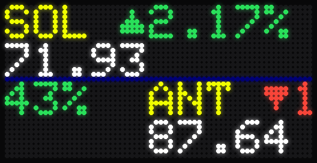<br>Two-row horizontal ticker, scrolling left</td>
<td align="center">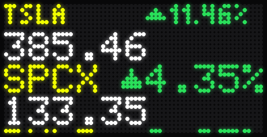<br>Vertical ticker, scrolling up</td>
</tr>
<tr>
<td align="center">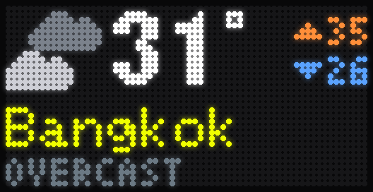<br>Weather now, with an animated icon</td>
<td align="center">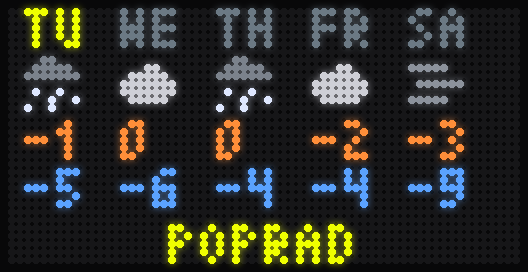<br>The 5-day forecast</td>
</tr>
<tr>
<td align="center">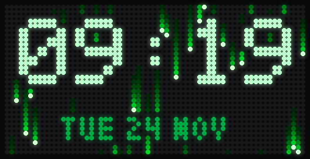<br>Clock: matrix</td>
<td align="center">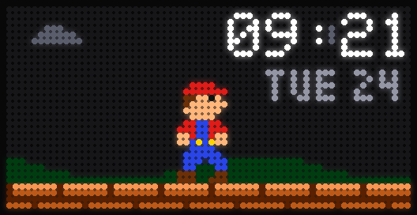<br>Clock: platformer</td>
</tr>
</table>

LED panels photograph badly, so these are frames taken from the device itself with [`tools/screenshot.py`](tools/screenshot.py) and drawn as LEDs: the colors are the ones the firmware draws, which is close to how the panel looks to the eye. All nine clock themes are under [Adding the clock](#adding-the-clock).

## What you need

- [Adafruit Matrix Portal S3](https://www.adafruit.com/product/5778) - the firmware's pins and memory layout are this board's
- A 64x32 HUB75 RGB panel with 1/16 scan. A P4 (256 x 128 mm) is what it was built on; any pitch works as long as it is 64x32 and 1/16 scan
- A USB-C cable that carries data, not just charge
- A 5 V USB-C supply, 2 A or more - see [Power](#power) before wiring the panel
- A computer with [PlatformIO](https://platformio.org/) and git

## Flashing

### 1. Install the tools

Either of these works:

- **VS Code with the PlatformIO IDE extension** - install [VS Code](https://code.visualstudio.com/), then search the extensions for "PlatformIO IDE". Easiest if you have not used PlatformIO before.
- **PlatformIO Core on the command line** - `pip install platformio`, then `pio` is the command used below.

No board drivers are needed: the Matrix Portal S3 shows up as a standard USB serial device on Windows, macOS and Linux.

### 2. Get the code

```bash
git clone https://github.com/tomasbkk/uptick.git
```

Or download the ZIP from GitHub and unpack it. In VS Code, open the `uptick` folder.

### 3. Connect the board

Plug the Matrix Portal S3 into the computer with the USB-C cable. The panel does not need to be connected to flash, but nothing is harmed if it is.

### 4. Upload the web page

The settings page lives on the board's filesystem, separately from the firmware, so it has its own upload.

- **VS Code:** PlatformIO sidebar -> Project Tasks -> uptick -> Platform -> **Upload Filesystem Image**
- **Command line**, from the `uptick` folder:

```bash
pio run -t uploadfs
```

### 5. Upload the firmware

- **VS Code:** PlatformIO sidebar -> Project Tasks -> uptick -> General -> **Upload**
- **Command line:**

```bash
pio run -t upload
```

The first build downloads the ESP32 toolchain and libraries, which takes a few minutes. Later builds take seconds. When the upload finishes, the board restarts and the panel shows the uptick splash with the firmware version.

PlatformIO finds the board on its own. If more than one serial device is plugged in and it picks the wrong one, name the port: `pio run -t upload --upload-port COM5` on Windows, `/dev/ttyACM0` on Linux, `/dev/cu.usbmodem*` on macOS. The same goes for `uploadfs`.

### 6. Connect it to WiFi

1. With no WiFi stored, the board starts its own network called `Uptick-XXXX`. Join it from a phone or laptop.
2. The setup page should open by itself. If it does not, browse to `192.168.4.1`.
3. Pick your network, enter the password and save. The board restarts and joins it.
4. For eight seconds after joining, the panel shows the network name, its IP address and `uptick.local`.

From then on the settings page is at **http://uptick.local** (or the IP address, if your device does not support `.local` names). The Tickers tab is where feeds are added; Display has the layout, brightness and theme; Settings has WiFi, data sources, colors and firmware updates.

To start over, use Forget WiFi on the Settings tab, or erase the board completely with `pio run -t erase` and flash again from step 4.

### If the upload cannot connect

- **No port appears:** try another cable - many USB-C cables are charge-only - and another USB port.
- **"Access denied" or "port busy":** something else has the port open, usually a serial monitor. Close it.
- **"No serial data received", "Write timeout", or the board seems dead:** put it into its bootloader by hand. Hold the **BOOT** button, tap **RESET**, release **BOOT**, then upload again. When the upload finishes, press **RESET** - the board cannot restart itself from this mode.

### Updating later

- **Firmware only** (most updates): `pio run` builds it, and Settings -> Maintenance -> Firmware takes the file from `.pio/build/uptick/firmware.bin` and installs it over WiFi. `pio run -t upload` over USB works too. Either way your settings are kept.
- **When the web page changes** (anything under `data/`): `uploadfs` rewrites the whole filesystem, and **that erases your saved settings** - feeds, layout and colors. WiFi and the CoinGecko key are stored elsewhere and survive. Back the settings up first and restore them after:

```bash
curl -o uptick-config.json http://uptick.local/api/config
```

```bash
curl -H "Content-Type: application/json" --data-binary @uptick-config.json http://uptick.local/api/config
```

Export and Import on the Tickers tab do the same for just the feed list.

### Other boards

Only the Matrix Portal S3 is supported as it stands. Another ESP32-S3 board with 8 MB of flash should work after editing the pins in `include/pins.h`. Classic ESP32 boards need a separate build setup that does not exist yet - see [Status](#status).

## Using it

Open **http://uptick.local** in a browser on the same network. The page has three tabs: **Tickers**, **Display** and **Settings**.

Brightness, what to show, layout, theme, clock theme, scroll speed and colors change on the panel the moment you touch them, so you can judge them before keeping them. Nothing is kept until you press **Save** - a bar that appears at the bottom of the page whenever there are unsaved changes, on any tab, and saves all of them. Restarting without saving brings back what was saved.

### Adding tickers

Each source names its symbols its own way:

| Source | What it covers | Symbol | Examples |
| --- | --- | --- | --- |
| binance | crypto | the trading pair | `BTCUSDT`, `ETHUSDT`, `SOLUSDT` |
| coinbase | crypto | the product id | `BTC-USD`, `ETH-USD` |
| coingecko | crypto, including coins Binance does not list | the coin id from its CoinGecko page address | `bitcoin`, `ethereum` |
| yahoo | stocks, ETFs, indices, futures, currencies | the ticker as Yahoo Finance shows it | `AAPL`, `SPY`, `^GSPC`, `GC=F` (gold), `EURUSD=X`, `SAP.DE` |

CoinGecko needs a free demo API key, entered under Settings -> Market data. The other three need nothing.

On the **Tickers** tab:

1. Press **+ Add Ticker**. The new row takes the source of the row above it.
2. Pick a **Source** and type the **Symbol** the way that source names it, as in the table above.
3. Press **check** to confirm the symbol exists and see its current price.
4. **Label** is what the panel shows. Leave it blank and it is made from the symbol, with a dollar quote dropped - `BTCUSDT` shows as `BTC`.
5. **Chart candle** sets how far back the chart reaches - the chart is 64 candles wide, and each choice in the list shows the span it gives for that source. **Decimals** at 0 picks sensibly from the price.
6. Press **Save**. Every new symbol is checked against its source first, and an unknown one stops the save rather than showing up as a feed that never loads.

Drag a row by its grip, or use the arrows, to change the order; **x** removes it. In the horizontal ticker the first half of the list runs along the top and the second half along the bottom, so the order also decides the row.

**Export** saves the feed list to a file and **Import** loads one back - worth doing before reflashing the web page, which erases saved settings.

### Adding weather

On the **Weather** tab:

1. Type a city into **Find a city** and press **search**.
2. Press **+ add** next to the right one. Up to 8 cities can be added; the arrows reorder them and **x** removes one.
3. **Name on the panel** is what the panel shows - shorten a long name here.
4. Pick **Units** and how many **Seconds per screen**.
5. Press **Save**. The device fetches the new cities within a few seconds, and the tab shows what it got.
6. On the **Display** tab, tick **weather** under **Show**.

Each city gets two screens: **now** - an animated icon, the temperature, today's high and low behind the up and down triangles, the city and the conditions - and **the week**, five columns of day, icon, high and low, with today first. With the tickers on too, the weather screens for every city play once after each full pass through them: after the last feed's turn on the chart, when the vertical list wraps back to the top, or when the horizontal tape has run through every feed and scrolled off.

### Adding the clock

On the **Clock** tab, pick a **Theme**, the **Time zone** - one of your weather cities, so add one on the Weather tab first - and how many **Seconds on screen** it gets between the other parts. Then tick **clock** under **Show** on the Display tab, and Save.

The clock shows the time and the date in 24-hour time, in a choice of themes. Changing the theme applies to the panel at once while the clock is showing, so they can be compared live:

| Theme | What it looks like |
| --- | --- |
| matrix | green rain streaming down behind large pale digits |
| flip | split-flap cards; a changing digit folds down |
| retro | a red seven-segment alarm clock, unlit segments faintly showing |
| pong | two paddles playing on their own, the score being the hours and minutes |
| tetris | each digit built from falling blocks whenever it changes |
| sky | the sky outside: real sunrise and sunset, sun and moon arcing over hills, stars at night |
| analog | a round face with a sweeping second hand, and the weekday, day and month beside it |
| platformer | a side-scroller: a plumber hits "?" boxes for mushrooms to grow, then stomps turtles - or gets caught by one and goes small |
| snake | a snake chases tiny mushrooms around the digits, growing as it eats, until it hits a digit or itself |

<table>
<tr>
<td align="center"><br>matrix</td>
<td align="center">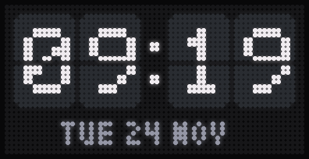<br>flip</td>
<td align="center">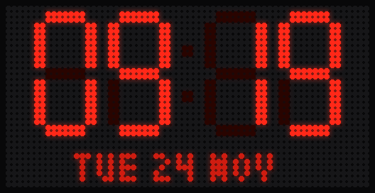<br>retro</td>
</tr>
<tr>
<td align="center">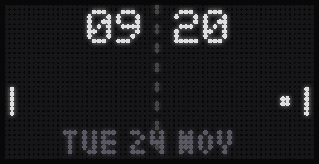<br>pong</td>
<td align="center">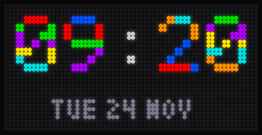<br>tetris</td>
<td align="center">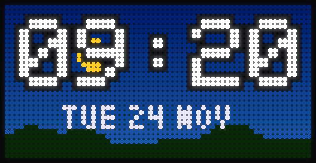<br>sky, in the morning</td>
</tr>
<tr>
<td align="center">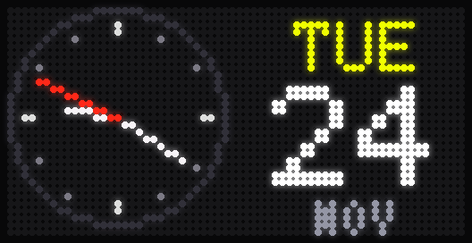<br>analog</td>
<td align="center"><br>platformer</td>
<td align="center">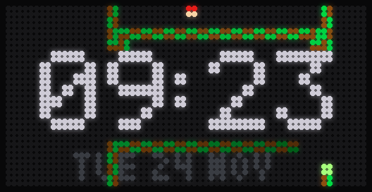<br>snake</td>
</tr>
</table>

With no city the clock shows UTC and says so.

### Choosing a layout

On the **Display** tab:

- **Brightness** - the panel is bright; a few percent is plenty indoors.
- **Show** - tickers, weather and clock, each ticked on or off. The panel goes through whatever is ticked in that order; one thing on its own stays up. With the tickers off, prices are not fetched. Applies at once, like the mode.
- **Mode:**
  - **single + chart** - one feed at a time with its chart, changing every **Seconds per feed**.
  - **ticker - horizontal scroll** - two rows of feeds crawling across the panel, at **Scroll speed**.
  - **ticker - vertical scroll** - the list rolling upward like a departure board. **Pause at each entry** holds each one for a moment.
- **Theme** - **christmas - falling snow** adds snow, a snowman or tree on the chart, and Santa now and then. **send Santa now** calls him over straight away.
- **rotate 180 degrees** - for a panel mounted upside down.

### Reading the panel

- The label is top left and the change is top right, with an up or down triangle, green for up and red for down. For stocks the change is against the previous close; for crypto it is the last 24 hours.
- The price is underneath. On the chart screen the chart is colored by its own direction, so a coin up on the day can still show a red chart if its chart span is falling.
- Stocks on the chart screen carry a small icon at the end of the price line: a rising **sun** for pre-market prices, a **moon** for after hours, and a **padlock** when the market is closed. No icon means the market is open and the price is live.
- A label in **orange** means that feed could not be refreshed and the price shown is old.

### Settings

- **WiFi** - power save (off keeps fetching steadier), and **Forget WiFi**, which restarts the board into setup mode.
- **Market data** - **Price poll** is how often prices are fetched. **Pause fetching** stops all fetching until a restart. The **CoinGecko API key** is stored on the board and never sent back to the page.
- **Palette** - every color on the panel, changed live and kept by Save. **reset to factory** brings back the defaults.
- **Maintenance** - install a firmware file over WiFi (see [Updating later](#updating-later)), and **Restore default settings**, which resets feeds, layout and colors but keeps WiFi.

## Hardware

- Adafruit Matrix Portal S3 (ESP32-S3, 8 MB flash, 2 MB PSRAM, HUB75 socket)
- P4 indoor 64x32 RGB panel, 1/16 scan, 256 x 128 mm
- 5 V supply

### Power

**The screw terminals are outputs, not inputs.** From Adafruit's pinouts page: *"they were designed as outputs ONLY - power from the USB port connects directly to these pads, so you should power from USB and then connect the matrix power inputs to these terminals."* Feeding those terminals from an external supply while USB is also plugged in can damage the board.

The HUB75 ribbon carries no power either - only signals and ground. The panel is always powered through its own spade pigtail.

That leaves two valid arrangements:

- **USB-C powers everything.** Supply into the board, panel pigtail onto the screw terminals. What the panel can draw is capped by the USB source: 500-900 mA from a laptop port, 1.5-3 A from a decent charger.
- **Panel on its own supply.** 5 V wired directly to the panel's power input, USB kept on the board for flashing and serial. Grounds tie together through the ribbon.

Never wire an external supply to the screw terminals.

The panel is 2048 LEDs. Full white is roughly 3-4 A; a ticker screen is mostly dark and sits in the hundreds of mA. The failure mode when the supply is inadequate is a brown-out - the board reboot-loops or the serial port drops - not gradual dimming. 1000 uF across the 5 V rail near the panel connector helps with power-on inrush.

### Panel wiring

1/16 scan uses address lines A-D only, so the board's address-E jumper stays alone. The 2x10 socket accepts the 2x8 IDC cable that ships with the panel.

Pin assignments live in `include/pins.h`. They are the Matrix Portal S3's own HUB75 pins, as Adafruit's examples for this board define them.

## Developer notes

```bash
pio run -t upload
```

```bash
pio run -t uploadfs
```

The second command is required whenever anything in `data/` changes - the web UI lives on LittleFS, and without it the device serves a diagnostic page instead.

`GET /api/files` reports what is actually on the filesystem. `totalBytes: 0` there means LittleFS found no partition: the Arduino wrapper looks the partition up by *label* and defaults to `spiffs`, so the entry in `partitions_8mb_ota.csv` has to be named `spiffs` even though it holds a LittleFS image. Renaming it to something descriptive silently breaks mounting, because PlatformIO still finds it by subtype and uploads the image to a partition the firmware never looks at.

Serial monitor:

```bash
pio device monitor
```

Note the monitor holds the port - close it before uploading or the flash fails with a permission error.

### Screenshots

```bash
pip install pillow
python tools/screenshot.py -o screen.png
```

saves what the panel is showing right now as a picture of LEDs; `--host` takes an IP address when `uptick.local` does not resolve, and `--pitch` sets the size of each LED in pixels (10 by default). The driver cannot read pixels back - its DMA buffers hold bit-planes, not colors - so the firmware keeps a plain copy of each frame as it is drawn: the panel object is a small subclass of the driver's that writes every `drawPixel`, line, rectangle and `fillScreen` into a 64x32 RGB565 array as well, and `flip()` copies that array out for `/api/screen`. Every frame starts from a cleared screen, so the copy is always a whole frame. The colors are as drawn, before gamma and brightness, which is why the pictures look the way the panel looks to the eye. The live endpoints - `/api/mode`, `/api/show`, `/api/theme`, `/api/clocktheme` - are the easy way to put a given screen up before taking one.

Every boot opens on a splash: the wordmark from the web page, "up" in white and "tick" in green, with the firmware version in the bottom-right corner. It stays up for at least 5 seconds, counted from when the panel starts, so a slow WiFi join leaves it up no longer than the join takes. Its colours are fixed rather than taken from the palette, so tuning the palette never changes the logo.

## Configuration

Settings are a single JSON document at `/config.json` on LittleFS, with a `schema` field so future firmware can migrate rather than silently misread an old shape. WiFi credentials and the CoinGecko API key live separately in NVS and are not part of the config document, so exporting config cannot leak them.

```json
{
  "schema": 1,
  "brightness": 5,
  "rotate180": false,
  "wifiSleep": false,
  "mode": "single_chart",
  "dwellSec": 15,
  "scrollSpeed": 20,
  "pauseSec": 0,
  "palette": { "DIVIDER": "#202020" },
  "refreshSec": 60,
  "feeds": [
    { "source": "binance", "symbol": "BTCUSDT", "label": "BTC", "interval": "1h", "decimals": 0 }
  ]
}
```

`mode` is `single_chart`, `ticker` (horizontal) or `ticker_vertical`. `ticker_vertical` was called `multi_price` before it scrolled; a config or backup that still says so is translated on load rather than refused, since refusing the stored config at boot would throw the whole document away, feeds included. Keys the firmware no longer uses - `bitDepth`, and `tz`, which was stored but never applied to anything - are ignored for the same reason. Up to 32 feeds (`UPTICK_MAX_FEEDS`); the web page reads the limit from `/api/status` rather than repeating it.

A label left blank is made from the symbol. Binance and Coinbase symbols carry their quote currency, which only costs width on a 64 px panel when it is a dollar, so `USDT`, `USDC`, `FDUSD`, `BUSD`, `TUSD` and `USD` quotes are dropped - BTCUSDT and BTC-USD both become BTC. Any other quote stays, since "ETH" over a price in bitcoin would misrepresent it, so ETHBTC stays ETHBTC. Stock symbols and CoinGecko ids are used as they are. The web page does this before saving and previews it in the label box as the symbol is typed; `config.cpp` does the same for a config POSTed without labels.

Factory feeds are BTC, ETH, SOL and ZEC on Binance. `decimals: 0` means "pick from magnitude" - whole dollars above $1000, cents below, four places under $1.

The `source` field is the extension point: `binance`, `coinbase` and `coingecko` for crypto and `yahoo` for stocks and everything else Yahoo Finance lists, each behind its own fetch adapter. The renderer never learns where the numbers came from.

### Symbols are checked before they are saved

Save checks every feed whose source and symbol are not already stored, and refuses a symbol its source does not recognise, marking the offending line. Unchanged feeds are not re-checked - they were checked on the way in - so saving thirty feeds after changing one costs one check.

| Source | How it is checked |
| --- | --- |
| Binance | its full symbol list, once - about 26 KB compressed |
| Yahoo | through the device, which asks spark for up to 20 at a time |
| CoinGecko | one `simple/price` request for all the ids |
| Coinbase | one request per product, in parallel |

Binance cannot be checked per symbol from a browser. It leaves the CORS header off its error responses, so the 400 for an unknown symbol is unreadable to the page - exactly what an unreachable Binance looks like. The full list is a 200 with the header.

A source that cannot be reached at all does not block the save: that says nothing about whether the symbol exists. The page saves and says how many could not be checked. Only the web page validates; a config POSTed to `/api/config` directly is trusted as given.

### Ordering feeds

The rotation follows the order of the `feeds` array, so reordering is an array move and nothing else. The web UI offers both a drag grip and up/down arrows; like every other feed edit, the new order is held until Save.

The device does not apply it mid-dwell. When the config arrives, the renderer looks up the feed that is currently on screen and follows it to its new index, so the panel keeps showing the same thing until its turn is up and the new order starts from the next rotation. A feed that was deleted outright falls through to the index clamp and the next swap picks up the new order regardless.

Quotes are indexed by feed position, so `configFromJson` carries each quote across to wherever its feed moved, matched on source and symbol; anything unmatched starts empty and refetches on its turn. Without that a reorder would print the previous occupant's price under the new feed's label until the next fetch. The same applies to adding and deleting, which had the bug before reordering existed. The poller's attempt timers are indexed by position too, and are simply reset - the worst case is one early refetch.

### Backing feeds up

**`pio run -t uploadfs` erases the saved config.** It rewrites the whole `spiffs` partition from `data/`, and `/config.json` lives in that partition, so every filesystem upload takes the feed list with it. Firmware uploads do not: `pio run -t upload` writes only `app0` at `0x10000` and leaves the filesystem alone. Only run `uploadfs` when something under `data/` actually changed.

**Export** and **Import** in the Feeds card exist for the times you do. Export downloads `uptick-feeds.json`; import reads it back, validates it and loads it into the form, and the feeds are stored when you press Save. The order that matters is export, then `uploadfs`, then import.

Both run entirely in the browser - the page already holds the config, so no endpoint is involved, and exporting captures what is on screen including edits that have not been saved yet. Import accepts three shapes, because all three turn up: an export file, a whole `/api/config` document, or a bare array of feeds. Anything unknown is normalised rather than trusted - an unrecognised `source` falls back to `binance`, an unrecognised `interval` to `1h`, `decimals` is clamped to 0-8 - and a file that fails validation leaves the feeds on screen untouched.

`interval` is the chart candle width, not the poll rate. 64 candles fill the panel's 64 columns, so it sets how far back the chart reaches. Yahoo has no 4h bar, so `4h` rounds to daily there - the same compromise Coinbase forces by rounding it up to 6h.

### Saving

Every setting the web page changes is one config document, so there is one Save: a bar that appears at the foot of the page whenever anything is unsaved, on any tab, and saves all of it. Brightness, what to show, mode, theme, clock theme, scroll speed, pause, power save and colors apply to the panel as soon as they change, so the effect can be judged before saving; everything else waits for Save. Pausing fetching and the CoinGecko key have their own buttons and are not part of the config.

Power save used to be applied only when WiFi joined, so saving a change to it did nothing until a restart. A config POST now applies it straight away.

### REST API

| Method | Path | Purpose |
| --- | --- | --- |
| GET | `/api/status` | mode, IP, RSSI, heap, uptime, colour depth and refresh rate, core assignments, task stack headroom, ticker frame time, feed limit |
| GET / POST | `/api/config` | the config document |
| POST | `/api/brightness` | live brightness, not persisted |
| POST | `/api/speed` | live scroll speed for both tickers, not persisted |
| POST | `/api/pause` | live vertical-ticker pause, not persisted |
| POST | `/api/mode` | live display mode, not persisted; the web page's mode picker uses it, so a mode applies as soon as it is chosen |
| POST | `/api/theme` | live theme, `none` or `snow`, not persisted - the same arrangement as the mode |
| POST | `/api/santa` | send Santa across on the next frame, while the snow theme is on |
| POST | `/api/clocktheme` | live clock theme, not persisted - the same arrangement as the mode |
| POST | `/api/show` | live `{"tickers":bool, "weather":bool, "clock":bool}`, not persisted - the same arrangement as the mode; all three off is refused |
| GET | `/api/weather` | the weather the device last fetched, per city |
| GET | `/api/screen` | the frame on the panel: 64x32 RGB565 pixels, little-endian, row by row, 4096 bytes - see [Screenshots](#screenshots) |
| GET / POST | `/api/palette` | live colour overrides by name, not persisted - the config's `palette` is what persists |
| POST | `/api/defaults` | restore factory settings and colours, leaving WiFi alone |
| POST | `/api/apikey` | store the CoinGecko key (write-only) |
| POST | `/api/fetch` | pause or resume market polling |
| GET | `/api/check?symbol=` | one Yahoo ticker's price, name and currency, for the check button (Yahoo sends no CORS header) |
| GET | `/api/check?symbols=A,B` | which of several Yahoo tickers exist, for the check before saving |
| POST | `/api/wifisleep` | toggle WiFi power save |
| GET | `/api/files` | list LittleFS contents |
| GET | `/api/scan` | visible networks |
| POST | `/api/wifi` / `/api/forget` | store or erase credentials, then restart |
| POST | `/api/update` | OTA firmware upload |

Plain HTTP on the LAN. Do not port-forward it.

## Architecture

Core 0 runs the radio, the web server and the market fetch. Core 1 runs the display. Confirmed rather than assumed - `/api/status` reports `coreDisplay` and `coreNet`.

Task stacks are measured, not guessed: `/api/status` reports `stackNet` and `stackDisplay`, the least free stack each task has ever had. The net task has 12 KB because it runs TLS handshakes and, on a save, holds a scratch `Config` plus two `String` arrays sized by the feed limit; measured with 32 feeds it bottoms out with about 5.6 KB free. The display task has 6 KB; the ticker's number formatting costs about 1 KB, and it bottoms out with about 3.3 KB free - on the original 4 KB it would have had 1.3 KB.

`Config` holds `String` members, so copying it deep-copies around forty strings. Both the render loop and the poll loop run far too often to do that per iteration, so `g_cfgRev` is bumped on every change and each reader caches its own copy until the revision moves.

The two mutexes (`CfgLock`, `QuoteLock`) are never held at the same time. Both readers copy config, release, then take the quote lock, so there is no lock ordering to get wrong. Where both have to move together - the quote remap on a config change - `displayPause()` brackets the pair instead, so no frame can observe the moment they disagree. That bracket must be released before `configSave()`, which pauses again and would deadlock on a non-recursive mutex.

Both guards tolerate a null handle. `configBegin()` loads the stored config through the same path a POST takes, so it takes the quote lock during `setup()` - and it used to run before `marketBegin()` created that mutex, which meant `xSemaphoreTake(nullptr, portMAX_DELAY)` and a boot that hung with the panel dark and nothing on serial past the banner. `marketBegin()` now runs first, and the null check means the same mistake degrades into working code rather than a brick.

Recovering from a hang like that is worth knowing: the S3's native USB ignores the RTS reset, so `esptool` cannot auto-enter the bootloader once the app stops servicing USB, and reports `Write timeout`. Hold BOOT, tap RESET, release BOOT to enter it by hand; flash; then press RESET, because `--after hard_reset` does not work over native USB either.

The web UI is read off LittleFS once at boot and served from a buffer in internal RAM, so a page load costs no flash reads.

## Data sources

Binance klines, which takes an exact count so the chart needs no resampling:

```
https://api.binance.com/api/v3/klines?symbol=BTCUSDT&interval=1h&limit=64
```

64 candles for 64 columns. Coinbase is supported too, which matters behind a US IP since Binance blocks those. Coinbase returns newest-first and Binance oldest-first; the adapter normalises to oldest-first so the renderer never has to know.

CoinGecko is supported for coins the exchanges do not list. Its symbol is the coin id (`bitcoin`, not `BTCUSDT`), it needs a demo API key, and it chooses its own granularity from the range requested rather than taking a candle size. Its free tier allows roughly 10k calls a month, so it suits slow polling only.

### Stocks, via Yahoo Finance

```
https://query1.finance.yahoo.com/v8/finance/chart/AAPL?range=1mo&interval=60m
```

Yahoo's chart endpoint was chosen because it is the only stock source still usable without a key or a subscription. One request returns the price, the change against the previous close and the candle series together, and a 404 is how it answers an unknown ticker, so validation needs nothing extra.

It is not only stocks. The same endpoint and the same three fields cover ETFs (`SPY`), indices (`^GSPC`), futures (`GC=F`), currency pairs (`EURUSD=X`) and non-US listings (`SAP.DE`, `VOD.L`). Tickers are percent-encoded, since `^` is not legal unencoded in a path.

Two things to know about it:

- **It is unofficial.** There is no contract and no support. If it changes shape, the adapter breaks. Yahoo also rejects a `curl/*` User-Agent with a 429 - `uptick/<version>` passes, but that is the sort of filter that can tighten without notice.
- **It sends no CORS header**, where the crypto APIs do on their normal responses. The web page cannot check a ticker from the browser, so those checks go through `/api/check` on the device instead.

Not every listing is priced in dollars, so the quote currency is read from the same response and carried on the `Quote`. The panel prints `$` only when the currency really is USD - a Frankfurt or London line prints bare, since the 5x7 font has no glyph for those and a wrong symbol is worse than none. The crypto sources are all USD pairs and are unaffected.

Alternatives were measured rather than assumed. Stooq now gates its CSV behind a JavaScript proof-of-work challenge, which an ESP32 cannot solve. Alpha Vantage, Finnhub, Twelve Data, marketstack, FMP, Tiingo and Polygon all require a key. IEX Cloud is gone. MarketData.app is keyless only for AAPL.

### Parsing

Candle responses are parsed by a hand-rolled streaming scanner (`extractField`) rather than ArduinoJson. ArduinoJson filters cannot select by index inside an array, so filtering could not isolate the close, and buffering the whole document would mean holding hundreds of fields of JSON in RAM at the same moment a TLS session is open. The scanner pulls one field straight off the socket with no allocation, handles both quoted strings and bare numbers, and keeps the *last* 64 values rather than the first - CoinGecko returns far more points than asked for and the recent end is the interesting one.

The 24h endpoints are objects rather than arrays, so ArduinoJson key filtering works there and is used.

Yahoo needs a second scanner (`extractYahoo`). Its series sits three arrays deep and its quote fields come back in no fixed order - `volume`, `high`, `close`, `open` and `low` have each been observed in different positions - so index-based extraction does not work on it. That scanner walks the stream once matching literal keys - the day's change, currency, last regular trade and trading sessions from `meta`, `"timestamp":[`, and `"close":[` from `indicators.quote[0]` - and gets the price, the day's move, the market hours and the chart out of a single pass. It reads to the document's closing brace rather than stopping after the close array: the top-level order moves too, and the extended-hours request has sent `indicators` before `timestamp` where the chart request sends it after. Stopping early lost the timestamps, so every pre-market price was discarded and the panel showed the market as closed. Bars that come back `null` are dropped rather than interpolated, and an unterminated trailing number on a truncated response is discarded rather than committed, since `13` may be the first two digits of `137.5`.

### Polling schedule

The layout decides how data is fetched.

**Single chart polls the feed on screen**, one candle request at a time, so an update lands while you are looking at it and a price moving is visible. The one exception is a feed that has no data yet - after boot, or just added - which is fetched during the previous feed's dwell, so its first turn opens on its chart rather than on "waiting for data". Once it has data it refreshes on its own turn again. The rest of the list is left alone, so effective refresh is the rotation period rather than the poll interval.

**Both tickers batch.** They show a price and a change per feed and no chart, which is what the batch endpoints return. One request per source replaces one per feed, every poll interval:

| Source | Batch request | Per request |
| --- | --- | --- |
| Binance | `/api/v3/ticker/24hr?type=MINI&symbols=[...]` | every symbol |
| Yahoo | `/v8/finance/spark?symbols=...&range=1d&interval=1d` | 20 at most - spark answers 400 above that |
| CoinGecko | `/api/v3/simple/price?ids=...&include_24hr_change=true` | every id |
| Coinbase | `/products/{id}/stats` | one - there is no batch endpoint |

Measured on the device with eight feeds across Binance and Yahoo: two requests a cycle, about half a second apart, and nothing else until the next one. At thirty feeds it is still two or three.

Each call to `marketPoll` makes at most one request, so the web server is serviced between them. Batch data updates price and change only; charts are left as they were and refilled when the chart layout is next on.

Details that each cost something to find:

- Binance `MINI` leaves out `priceChangePercent`. It is recomputed from `openPrice`, which opens the same rolling 24 hours, so the figure is identical.
- Symbols are deduplicated before they go out. Binance refuses a list that names one twice (`-1151`), and the same symbol can legitimately sit in two feeds with different chart spans; each result is applied to every feed that carries it.
- Binance also refuses the whole list over one symbol it does not recognise (`-1121`), which is why the web page checks symbols before saving. A coin delisted after it was added would still take every Binance feed stale with it - visibly, since they would all show it.
- Yahoo and CoinGecko simply leave unknown symbols out of a mixed answer. Spark answers 404 when it recognises none of them.
- Spark carries no currency. A Yahoo feed that has only ever been batch-fetched prints no currency symbol rather than a possibly wrong `$`; its first chart fetch teaches it the real one.

### HTTP/1.0, and chunked responses

Every request is made with `useHTTP10(true)`. The parsers read `getStream()` raw, and `getStream()` does not undo chunked transfer encoding: the chunk-size lines arrive in the byte stream mixed into the JSON. CoinGecko and Coinbase both chunk over HTTP/1.1, which silently broke their 24h lookups - the parse stopped at the first chunk header - and could splice hex digits into a chart price wherever a chunk boundary fell mid-number. HTTP/1.0 has no chunked encoding; all six endpoints were checked to answer it with a plain body.

## Display

### Layout

64 x 32 is tight. Row budget for `single_chart`:

```
rows  0-6    BTC            ▲4.37%     5x7 font, 6px advance
row   7      blank
rows  8-14   $214,460                  price
row   15     blank
rows 16-31   chart, 64 cols
```

`$214,460.00` is 66 px in the 5x7 font - one pixel too wide. The price line steps down a ladder: full precision in the 5x7 font, then TomThumb 3x5 at 4 px advance, then a `$214.4K` abbreviation. Thousands separators are inserted into the integer part only.

Direction is shown by a triangle, not a sign - the same as the ticker - with the figure itself unsigned. When the label and change are too wide for the 5x7 font the line drops to TomThumb, which covers printable ASCII only, so there the triangle is drawn as a shape, 5 wide by 3 tall, centred on the small digits.

Text wrapping is turned off. Adafruit_GFX wraps using the glyph advance rather than its ink, so a right-aligned string ending flush at column 63 still trips the check, and that last character gets redrawn at x=0 on the following line in its own colour - which showed up as the percentage's green painted through the `$` of the price.

The chart scales to the min/max of the visible window, never to zero, or intraday moves would render as a flat line. The trace runs along the fill's top edge as a staircase, never as a line between column centres: `drawLine` spreads a steep move across both columns, so half of it lands above the previous column's fill as stray pixels floating over the chart.

### Ticker

Two tapes crawling right to left, the way an exchange board or a business channel's crawl does. Each is a 16 px section holding two lines of the 5x7 font - 7 + 1 + 7 + 1 - so every entry is a small block, label and change above and price below:

```
rows  0-15   BTC ▲1.73%   ETH ▼2.52%   SOL ▼2.2      first half of the feeds
             84,434       2,676        114.78
rows 16-31   TSLA ▲0.44%  AAPL ▼1.58%  MSFT ▲        second half
             380.56       152.27       3.685
```

The first half of the feed list runs along the top and the second half along the bottom, with the odd one out on top, so reordering the feeds is how to choose which section a feed is in - crypto above and stocks below, say. A single feed gets one section, centred. The change sits behind a triangle coloured by direction; CP437 `0x1E` and `0x1F` in the built-in font are solid up and down triangles. There is no currency symbol: a tape is read as figures, and a prefix would only be right for the feeds priced in dollars.

Row 15, the blank row between the sections, carries a dark grey divider in the `DIVIDER` palette colour. Being in the blank row, it touches neither section's text.

A block is only as wide as its longer line, which makes it around 40% narrower than the same entry on one line, so more of them pass at the same speed.

An entry's text is frozen when it enters at the right edge. A price that changed mid-crawl would change the block's width while it moved and shunt everything behind it, so the next pass carries the new figure instead - which is how a real tape behaves. Each section holds only the entries in view, retiring them as they leave on the left and taking the next feed as soon as there is room behind the last.

The tape moves one pixel a frame, so `scrollSpeed` (pixels per second, 10-90, default 20) is also its frame rate, paced with `vTaskDelayUntil` so it holds steady. The web page sets it with a slider that previews live through `/api/speed`, like brightness, and Save keeps it. 30 read as a little fast on the real panel with both sections moving. Much below 15 the motion starts to look stepped, because each step is a whole pixel.

Measured on the device with 32 feeds: a frame draws in about 0.75 ms, a few percent of its budget at any speed the slider allows, reported as `tickerDrawUs` in `/api/status`. Frames are drawn to the back buffer and flipped with the two-frame guard described under double buffering. The ticker is the one screen that bypasses `FrameKey` gating; it stands aside for the setup and just-joined screens.

It uses batch fetching, so thirty feeds cost two or three requests a poll cycle.

### Vertical ticker

The whole feed list rising up the panel and looping, two entries in view. Each entry is the same block as the top of the chart screen - label and change on one line, price below - drawn by the same `drawQuoteHeader`, so the two screens read alike. The tickers print figures without a currency symbol, because a Yahoo feed that has only been batch-fetched does not know its currency, and a list where BTC has a `$` and TSLA does not reads as a mistake. The chart screen keeps it.

With `pauseSec` at 0 the list crawls continuously at `scrollSpeed`. With a pause it holds each time an entry reaches the top, then rises one entry and holds again, the way a departure board does. That is easier to read: vertical motion moves every character at once, where a horizontal crawl brings text in along the direction it is read.

Unlike the horizontal tape, entries are drawn live every frame rather than frozen - moving vertically, a price that changes width shifts nothing else. Rows above the panel are clipped by the driver: its pixel path takes unsigned coordinates, so -1 wraps past the height check, and its line paths test for negatives explicitly. A frame draws in about 1.5 ms.

A list of one or two fits the panel as it is and does not move.

### Themes

A theme is an animated layer behind the feeds, picked on the Display tab. Like the mode it applies at once through `/api/theme`, and Save keeps it as `theme` in the config. An unknown theme in a stored config or backup loads as `none` rather than failing the document.

`snow` is the Christmas theme: 22 flakes, 8 near and 14 far. Near flakes fall at 4-6 px/s, drift up to 1 px/s sideways and sway 2-3.5 px either side; far ones fall at 2-3.5 px/s, drift and sway less, and are drawn at under half the brightness, which reads as depth. Each flake gets its own speed, drift and sway when it spawns. Positions are floats moved by the real time between frames, so the snow falls at the same pace whatever frame rate the mode runs at - the tickers run at their scroll speed, the chart at 30 fps.

Every feed screen clears through `clearFrame()`, which draws the snow straight after the clear and before anything else. That puts it behind the content: flakes show between the letters and never cover a figure. The setup, splash and test screens clear for themselves and never show it.

On the chart screen the near flakes settle on the chart; the far ones carry on and pass behind its fill. `chartColumns()` works out the chart's top edge per column before the frame is cleared and hands it to the snow, so the same numbers draw the chart and decide where snow lands:

- A near flake lands when it reaches the row above the ground - the chart's top edge less any snow already there. Only within a couple of rows of it: a flake already well below, placed there when the theme came on or overtaken by a chart that rose past it, is behind the chart and keeps falling.
- It rolls downhill first. While a neighbouring column's ground is two or more rows lower it moves there, so snow gathers in the chart's dips instead of balancing on its peaks.
- A column holds at most 3 px of snow and never piles into the header rows; a flake with nowhere to go melts on arrival.
- One pixel melts from a random column every 2.5 s, so a feed left up for a long time keeps a dusting rather than filling in.
- Each feed's chart starts with bare ground. The snow was lying on a chart that is no longer there.

Santa flies across every two to five minutes while it snows, the first time 20-40 s after the theme comes on so that turning it on shows him rather than leaving it to chance. "send Santa now" on the Display tab, or `POST /api/santa`, sends him on the next frame. He is a 34x11 sprite - Santa in a sleigh behind two reindeer, Rudolph's red nose in front - stored as rows of characters, one per pixel, with the colors in `santaColor()` rather than the palette, the same as the boot logo. Two frames swapped four times a second make the reindeer gallop. Each flight picks a direction, mirroring the sprite so the reindeer always lead, and a height, and bobs a pixel either way; he crosses at 12 px/s, about 8 s.

Unlike the snow he is drawn over everything, after the screen's own content. He is up for a few seconds at a time, and behind the figures he would be mostly hidden. He adds about 0.2 ms to a frame.

Each time a chart comes on screen while it snows, it gets a snowman or a Christmas tree, picked at random, standing on the chart wherever there is room. Both are 7x10 sprites in the same format as Santa; `K` is drawn black rather than left transparent, so the snowman's eyes and buttons do not show the snow behind them, and the tree's three ornaments cycle through red, yellow and blue every 0.6 s so it twinkles. The tree's branches are a pine teal rather than a plain green, which blended into a rising chart's green fill and trace.

- It stands on the lowest ground under its seven columns, so it never floats; where the ground is higher it overlaps the chart, which reads as standing in front of a slope.
- A spot counts only if the ground under it is no more than 3 rows uneven and its top stays below the price - row 15, the blank row above the chart, at the highest. If nowhere fits, that chart goes without.
- It keeps its spot while the spot still fits, so a chart that shifts a little on a new fetch does not move it. Otherwise it is placed at random among the spots that fit, one column in from either edge.
- It is drawn after the chart: in front of the chart and the falling snow, behind Santa.

The size was measured rather than guessed. Against a dozen real 64-bar charts, a 10-row figure with that flatness rule finds room on about five charts in six; at 12 rows it was half of them, because every chart is scaled to fill all 16 rows and only its lower stretches leave the height.

The chart is normally redrawn only when something changes. With a theme on it joins the tickers as an animated screen at 30 fps. Measured with snow, a frame takes about 2.6 ms on the chart with landing, 1.1 ms on the horizontal ticker and 1.8 ms on the vertical one (`tickerDrawUs` in `/api/status`).

Adding the snow changed how GCC inlined `drawChart`, and the Xtensa compiler then failed with an internal compiler error (`insn does not satisfy its constraints`) on a float `?:` in the chart's scaling. That check is now an `if` outside the loop and `drawChart` is `noinline`. If the same error appears after some other change, look for a float conditional in a function that has just started being inlined.

### The percentage is always 24h

The chart span is per-feed and adjustable; the percentage is always the fixed 24 hour change, so it stays comparable between feeds whose charts cover different spans. The two disagree routinely - a coin can be flat over a day and up 8% over a 64 hour chart - so the percentage is tinted by the percentage and the chart by the chart. Colouring a visibly falling line green to match a positive 24h figure would be a lie.

At `1h` candles the 24h figure comes free from the candles already fetched, 24 bars back. Only `5m` and `15m` feeds trigger a second request, since 64 of those candles do not span a day.

For a Yahoo feed it is the move against the previous close, not a rolling 24 hours. A rolling window is meaningless for something that trades 6.5 hours a day, and the previous close is the number every quote page prints. Yahoo supplies it in the same response, so no second request is needed during the regular session. Pre-market and after hours, the chart screen shows the extended-hours price and its change instead - see market hours below. Once trading stops the price holds and the figure stops moving - that is correct, not a stalled fetch, and the stale indicator stays off because it tracks fetch failures rather than data age.

### Market hours

On the chart screen a stock's price carries an icon at the right edge, under the change figure, saying whether it is live:

| Icon | When | Price and change shown |
| --- | --- | --- |
| none | regular session | the live price, against the previous close |
| rising sun | pre-market, 4:00-9:30 in New York | the pre-market price, against the previous close |
| crescent moon | after hours, 16:00-20:00 in New York | the after-hours price, against today's close |
| padlock | closed - overnight, weekends, holidays | the last regular close and its day change |

The hours are not hardcoded. Every Yahoo chart response carries `currentTradingPeriod`, the exchange's pre, regular and post sessions for the trading day as Unix times, so this works for any exchange, including ones with no extended hours. The device keeps UTC from SNTP (`pool.ntp.org`), started once WiFi joins, and compares against those. Until the clock syncs, no icon is shown.

The extended-hours price is a second request, made only while an extended session is on: today at 5-minute bars with `includePrePost=true`, of which only the newest real close is kept. The chart request cannot supply it - Yahoo's keyless meta has no pre- or post-market price, and asking the chart request for extended hours would put those bars in the chart too, over twice as many per day, so 64 columns would cover under half the history.

A session only counts as live if the price actually traded in it. A quote whose last trade is from before the session opened means nothing has traded yet - which is what a holiday looks like, since Yahoo can still report a regular session for one - so it shows the padlock. So do the first minutes of pre-market, before anything trades.

The state is worked out at draw time, so the icon changes when the session does, not when the feed next comes round. Crypto never shows one. The tickers do not either: Yahoo's batch endpoint breaks when asked for extended hours, answering 400 or returning timestamps with no prices, so they stay on regular-session prices.

### Palette

Sixteen named colors, all overridable live through `/api/palette` and the web UI's color pickers: `LABEL`, `PRICE`, `PCT_UP`, `PCT_DOWN`, `FILL_UP`, `TRACE_UP`, `FILL_DOWN`, `TRACE_DOWN`, `DIM`, `ACCENT`, `STALE`, `DIVIDER`, `SUN`, `MOON`, `CLOSED`, `SNOW`. `DIVIDER` is the line between the horizontal ticker's sections; set to black it disappears. `SUN`, `MOON` and `CLOSED` are the market-hours icons, and `SNOW` is the snow theme's near flakes - the far ones are the same color at 45%.

A picker applies its colour at once through `/api/palette`, which is RAM only, and raises the page's save bar; Save stores the palette in the config with everything else. Only the colours that differ from factory are stored, by name, so a colour nobody changed follows the factory set if that is ever retuned - and a config with no `palette` at all means factory, so what is on flash always says exactly what the panel shows. Unknown names and malformed colours are skipped rather than refused. Reset to factory, and Restore default settings, both bring the factory set back.

The palette starts at factory before anything else runs, not in `displayBegin()`: the stored config is loaded, and its colours applied, before the panel is brought up.

The factory set itself was tuned on the panel with the pickers and exported from the page with "export as C++" - a `PAL_FACTORY` table to paste into `display.cpp`. The page used to keep picks in the browser's local storage and push them back over the device on every load; that is gone now the device keeps them, and the page clears the old entry.

### Brightness

Brightness is the panel's output-enable duty cycle, set with `setBrightness8()`. Every draw call clears only the six RGB bits of each DMA word and OE is bit 7, so brightness is written once and survives all redraws; it is re-applied only when the value changes, because it walks both buffers.

The slider is linear - 5% means 5% duty, so a stored value keeps its meaning. No floor is needed: the driver keeps at least one pixel-clock of output per bit-plane for any non-zero value, so 1% is dim but never dark, and visibly different from 5%.

Dimming by duty cycle keeps the palette exact at every level. The alternative, scaling every color down in software, loses dark colors below what the panel can show - measured at 4-bit and 40%, green 220 rendered while 95 and 74 went black - and shifts hues, because the components do not scale in proportion: a warm red turns orange as brightness rises.

### Colour depth and refresh

Depth is fixed by the build: `-DPIXEL_COLOR_DEPTH_BITS=7` in `platformio.ini`. It cannot be a runtime setting. The driver picks its CIE 1931 gamma table from that macro at compile time and uses the table's output unshifted, so a runtime depth that differs drops the top bit of every bright colour. Its own fallback for mismatched depths is dead code - the fallback branch defines `LUT_NATIVE_BIT_DEPTH` as `0` and the code tests it with `#ifdef`, which is true either way. `include/pins.h` derives the runtime depth from the same macro, so the two cannot drift. Native tables exist for 4, 6, 7, 8, 10 and 12 bits.

The gamma table also sets how dark a colour can go before it becomes black. Every palette component survives at 6 bits and above; at 4 bits, `PCT_UP`'s red (41) and `STALE`'s blue (41) both vanish.

Refresh is computed by the driver from clock, depth and scan, and reported as `refreshHz` in `/api/status`. With no CPU in the refresh loop the rate cannot vary, so there is nothing to measure. Computed for this panel at a 16 MHz clock:

| Depth | Refresh |
| --- | --- |
| 5 | 781 Hz |
| 6 | 422 Hz |
| **7** | **223 Hz** |
| 8 | 115 Hz |

7-bit at 223 Hz is the build default, and matches what the device reports. The two DMA buffers take about 55 KB of internal RAM.

The S3 divides a 160 MHz source, so the driver rounds a requested clock to 10, 16 or about 23 MHz. 16 is the one where requested and real match; asking for 8 actually runs at 10, while the driver still computes refresh from 8 and under-reports by a fifth.

### Double buffering

Drawing goes to a back buffer and `flipDMABuffer()` swaps. A flip only rewires the last descriptor of each chain, so the DMA moves across when it finishes the frame it is on - up to one frame after the call returns. Until then the buffer that drawing now targets is still on screen, and writing to it tears. The driver's wait for this is commented out on the S3, so `waitForFlip()` enforces it: nothing is drawn until two frame periods after a flip. The guard is about 9 ms at 223 Hz, and the animated screens draw a frame every 11-100 ms, so it rarely has to wait.

Every screen starts by clearing the whole buffer, which matters here: the back buffer holds the frame from two flips ago, not the current one.

## Weather

Forecasts come from [Open-Meteo](https://open-meteo.com/), which needs no key and no account, like the rest of the default sources. One request covers every city: `latitude` and `longitude` take comma-separated lists, and the answer is a JSON array with one object per city in the same order - a single city comes back as a bare object, which the parser handles too. `timezone=auto` gives each city its own local days, so a forecast for Bangkok starts on Bangkok's today. Five days for one city is about 650 bytes, so it is parsed with ArduinoJson behind a filter rather than streamed by hand like the candles.

```
https://api.open-meteo.com/v1/forecast?latitude=13.754,49.061&longitude=100.501,20.298
  &current=temperature_2m,weather_code,is_day
  &daily=weather_code,temperature_2m_max,temperature_2m_min
  &timezone=auto&forecast_days=5
```

`weatherPoll()` runs on the net task beside `marketPoll()`. It fetches every 15 minutes - Open-Meteo only updates current conditions that often - a minute after a failure, and at once when the cities or the units change. It notices that itself by comparing the units and every coordinate against what the data on hand was fetched for, and drops that data straight away when they differ, so a reordered list never shows one city's weather under another's name. With neither the weather nor the clock on it fetches nothing.

City search runs in the browser against Open-Meteo's geocoder, which sends a CORS header, so the device is not involved until the list is saved. Cities are stored in the config as `cities`, each a `name` (at most 24 characters) with `lat` and `lon`, alongside `weatherUnits` (`c` or `f`) and `weatherSec`. As with the theme, unknown values load as defaults and nonsense coordinates are skipped rather than failing the document.

Conditions are WMO weather codes, grouped into eight kinds for drawing: clear, partly cloudy, cloudy, fog, drizzle, rain, snow and thunder. The now screen's icons are animated at 20 fps - the sun's rays alternate, the moon's stars twinkle in turn, clouds drift, rain, drizzle and snow fall at their own speeds with every column out of step, and thunder flashes - and the week's are 7x7 and still. The week screen shows five days in 12 px columns. Seven 9 px columns fit as well, but only two characters each: a three-character temperature, -10 and below or 100 and up, ran straight into the next day's figure. Five days fit three characters with a gap, so every city gets the same week whatever its climate. The temperature is in the same bold font as the boot logo; the colors are the weather's own rather than palette entries, like Santa's. Night is Open-Meteo's `is_day`, so the moon appears at the city's own sunset.

The weather and the clock join the tickers through the rotation described under [Clock](#clock).

Measured with two cities: a fetch arrives about 3 s after a save, a weather frame draws in 1.4-2.6 ms against a 50 ms budget, free heap holds steady at about 128 KB, and the net and display tasks keep 5.3 KB and 3.4 KB of stack in hand.

## Clock

Every theme gets the same `ClockTime` - the clock city's local hour, minute, second and fraction of a second, the date, and that day's sunrise and sunset - and draws the whole panel itself. They share the 5x7 font's digit shapes, kept as a small table (`DIG5`) so the themes that build digits out of something else - cards, blocks, the analog date - can scale or rebuild them.

The time is the clock city's. The device keeps UTC from SNTP, and every Open-Meteo answer carries the city's `utc_offset_seconds`, which follows daylight saving - so there is no time zone table and no POSIX TZ string to get wrong. That is why the weather fetch also runs when only the clock is on, and it now asks for each city's sunrise and sunset too, for the sky. With no city, or before its first fetch, the clock shows UTC and adds `UTC` to the date; before SNTP has set the clock it shows `--:--`. It is stored as `clockTheme`, `clockSec` and `clockCity` (an index into `cities`); an unknown theme loads as matrix.

Every animation runs on real time rather than a step per frame, and a theme starts from its beginning whenever the clock comes up or the theme changes.

- **matrix:** each column has at most one drop, a near-white head with a tail fading to dark green on a square curve, 5-14 rows long, falling at 10-26 rows a second, with a pause of up to 2.5 s before the next. It starts mid-flow. The digits are the 5x7 font doubled, with a one-pixel black outline so the rain stops short of them.
- **flip:** a changing digit's card folds in two steps of 0.2 s - the old top half squashes down toward the split, uncovering the new top half, then the new bottom half unfolds over the old one. Each card is drawn pixel by pixel from the digit table, so a half-folded card is just a squashed range of rows.
- **retro:** seven-segment digits 11x22 with 2-pixel segments, unlit ones drawn in a dim red, and a colon that blinks with the seconds.
- **pong:** the hours are the left score and the minutes the right. When the minute turns the left paddle heads away from the ball and the right side scores; when the hour turns, the right paddle does. Any other time a paddle never misses - it is moved under the ball, which only ever takes a pixel or two - and the score on screen only catches up with the clock when a point is scored. Unlike the other themes, which start from their beginning each time the clock comes round in the rotation, a game in progress carries on where it left off, as if paused; only the first time, or choosing pong after another theme, starts a new one.
- **tetris:** when a digit changes it clears and its 2x2 cells drop in one at a time, bottom row first, at 90 rows a second. Cells are colored four at a time, so the digit looks stacked from tetrominoes.
- **sky:** an hour either side of sunrise blends night to dawn to day, and an hour either side of sunset day to dusk to night, from the clock city's real times. The sun crosses from horizon to horizon through the day and the moon through the night, stars twinkle once it is dark, over two sine waves of hills. Without sunrise and sunset it assumes six and six.
- **analog:** hour, minute and a red second hand that sweeps, using the fraction of the second from `gettimeofday`; the weekday, the day of the month in doubled digits and the month on the right.
- **snake:** the panel as a 32x16 board of 2x2 cells with the edges wrapping, the time as solid blocks in the middle. Each step the snake takes the move that brings it closest to the mushroom among those leading into enough room for its body - a flood fill from each candidate, stopping once it has counted one more cell than the snake is long - and one step in 25 it takes any move that merely avoids a crash. Each mushroom adds two cells. The body is marked like a snake's skin: across its two-pixel thickness one pixel is green and the other brown, swapping sides from segment to segment, with the thickness taken across the way the body runs at that point. The side follows the segment's place in the ring rather than its distance from the head, so the markings travel with the body instead of flickering at every step. With no moves left it flashes red and white for 1.5 s and a new snake of four starts. The numbers came from simulating a hundred games against real digits: one-cell lookahead alone lived a median of 14 s, the space check with no careless moves could run for an hour, and 4% careless moves gives a median of about two minutes and a length of around 66 at death. A new minute that lands a digit on the mushroom moves the mushroom. Mushrooms are not placed in a corner or pocket of a digit - walled on two sides or more - because the space check rightly keeps the snake out of a one-cell gap, so it would circle one there for good; and a mushroom still uneaten after 20 s, walled off by the snake's own body for instance, blinks for two seconds and moves. Simulated across four different times, the placement rule halved the mushrooms that went 20 s uneaten, from 5.3% to 2.5%, and the timeout takes care of the rest. Like pong, a game in progress carries on when the clock comes round again.
- **platformer:** a side-scroller. The plumber runs on the spot in the middle, at column 27, while the ground scrolls at 20 px/s, the hills behind it at half that and two clouds at a quarter. While he is small, "?" boxes come along: he jumps so the top of his jump meets the box - he leaves the ground when the box is as far off as it covers in the climb, `sqrt(2h/g)` - and a mushroom rises out of it, slides off as it moves through the world a little faster than the scroll, drops and makes him grow. While he is big, turtles walk at him: two times in three he jumps when the turtle is as far off as it will cover during the jump and stomps it, and it turns into a shell kicked off the edge; otherwise it touches him, and he flickers, shrinks and blinks for two seconds. Everything runs on gravity and timed jumps rather than a script, so it plays out a little differently each time; simulated for ten minutes it hit 35 boxes, grew 35 times, stomped 84 turtles and was caught 34 times. The clock stays put in the top right, outlined, with the world scrolling under and behind it: a box is hit above the plumber and scrolls on left while the mushroom rises, so things pop up on the left, and the clock starting at column 35 leaves even his highest jump clear of it. The art is drawn for this clock in the style of the old platform games, not copied from any. About 3.5-4 ms a frame.

Frame times measured on the device: matrix 6.5 ms, sky 5.4, flip 3.1, snake 1.4, tetris 1.3, retro 1.1, platformer 3.8, analog 1.0 and pong 0.8, against 33 ms at 30 fps.

### The rotation

What the panel shows is three switches, `showTickers`, `showWeather` and `showClock`, played in that order and skipping whatever is off. The tickers end after a full pass through the feeds, the weather after every city's two screens, the clock after `clockSec`. Whatever is on alone just stays up. All three off is refused by `/api/show` and turned back into tickers on load, so the panel is never blank. Weather with no city is left out of a rotation, but on its own it shows how to add one. Configs from 0.26, which stored a single `show` of `tickers`, `both` or `weather`, load as the switches they meant.

Each ticker reports the end of a pass through `s_lapDone`, set only while something else is waiting (`s_lapWanted`). The chart's pass ends with its last feed's turn, and the vertical list's when it wraps to the top; a vertical list of two or fewer does not move, so its pass is a dwell. The horizontal tape has no natural end, so it is given one: when the top row has fed in its last feed, `s_tickDrain` stops both rows taking more, and the pass ends once the tape has scrolled off empty. It restarts full from the left afterwards, through the same reset as choosing the mode. The test screens are never interrupted. Every change of part is logged on serial as `[disp] showing ...`.

## Display driver and WiFi

A HUB75 panel has no framebuffer and no PWM. One row-pair is lit at a time, and grayscale comes from showing each bit-plane for a weighted duration, so something has to keep shifting rows out hundreds of times a second.

Here that is the ESP32-S3's LCD peripheral, through the ESP32-HUB75-MatrixPanel-DMA driver. Every bit-plane of every row, latch and output-enable timing included, is laid out as a ring of DMA descriptors in internal RAM that the peripheral walks forever. No interrupt fires and no CPU is involved, and internal RAM needs no cache, so nothing the firmware does - TLS handshakes, flash writes, serving the web page - can make the panel flicker. `displayPause()` / `displayResume()` remain only so `configFromJson` can swap the config and the quotes without a frame being drawn from one new and one old.

An earlier version drove the panel with Adafruit_Protomatter, which needs a timer interrupt between every bit-plane, and anything that delayed one showed as flicker. Moving to the DMA driver is what ended that.

### Drive strength

The driver sets every HUB75 pin to the S3's maximum drive strength, level 3 (about 40 mA). On this board that wrecked WiFi. Measured by ping from the LAN, same position, RSSI -37 dBm throughout:

| Configuration | Replies | Median | Max |
| --- | --- | --- | --- |
| 16 MHz, drive 3 (driver default) | 21/30 | 955 ms | 1935 ms |
| 10 MHz, drive 3 | 30/30 | 16 ms | 157 ms |
| 16 MHz, drive 1 | 40/40 | 45 ms | 407 ms |
| **16 MHz, drive 0** | **40/40** | **2 ms** | **6 ms** |

It is RF, not bus contention. Changing edge speed at a fixed clock changed the result, which bus load would not care about - and the DMA stream is at most 32 MB/s against roughly 960 MB/s of internal RAM bandwidth. The antenna sits a few centimetres from these lines, and the driver clocks continuously, repeating each row up to 32 times a frame, so the lines are never quiet.

`displayBegin()` therefore overrides every HUB75 pin to `HUB75_DRIVE` (0) after `begin()`. Too low a drive could in principle shift the wrong bit at 16 MHz, showing as speckled pixels; on this board, with the Matrix Portal plugged straight into the panel, drive 0 is clean. A board that reaches the panel over a ribbon cable may need 1, and possibly 10 MHz to get WiFi back.

## Status

Working: provisioning, captive portal, web config, live palette tuning, OTA, flicker-free DMA rendering with hardware brightness, chart and both scrolling tickers, tabbed web UI, Binance / Coinbase / CoinGecko / Yahoo adapters with batch fetching, pre-market and after-hours prices with market-state icons, symbol checks on save, up to 32 feeds, feed reordering and export/import, weather for up to 8 cities, a clock with nine themes, a rotation through any of tickers, weather and clock, and the Christmas theme.

Ideas, roughly in order of value:

- Buttons for feed cycling, LIS3DH tap-to-advance and orientation
- ESP Web Tools + Improv for browser flashing and provisioning
- A second PlatformIO environment for plain ESP32 boards (needs a pin remap and a 4 MB partition table)
